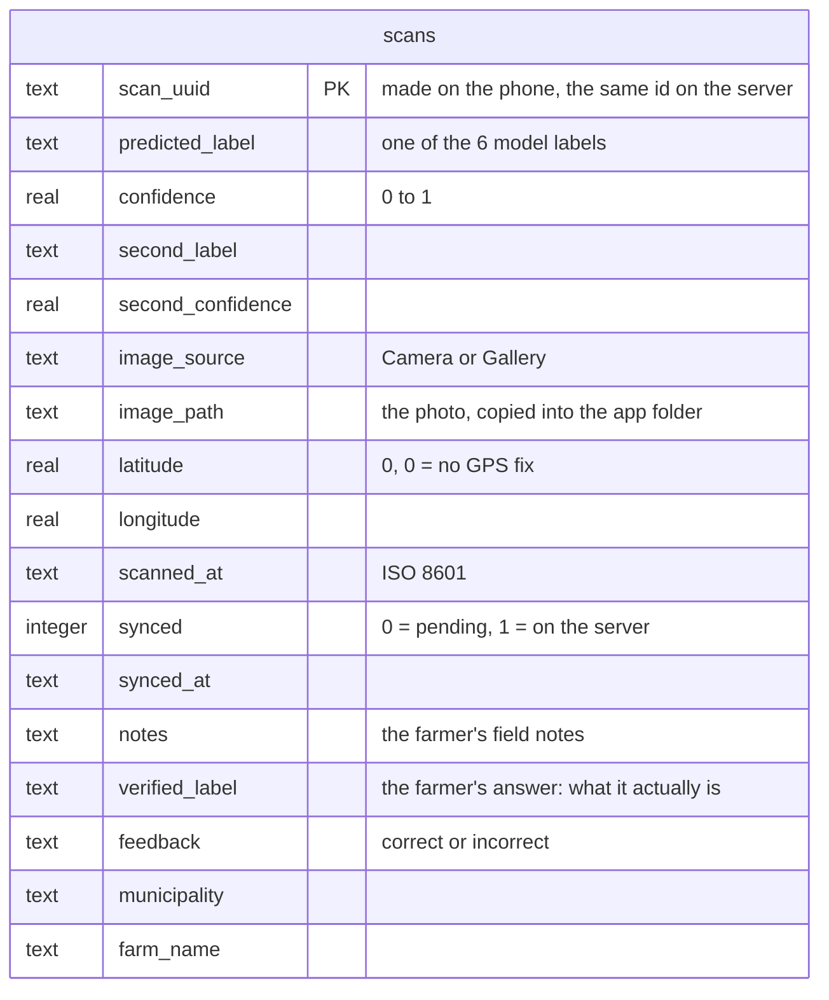

# PinePal Mobile: data on the phone

The app is offline-first: every scan is saved on the phone first, in a small SQLite database
(`pinepal.db`, `lib/services/database_helper.dart`, schema version 4), and uploaded to the server
when there is internet (`lib/services/sync_service.dart`). This page shows what the phone keeps and
how it maps onto the server's MySQL tables. The server's own diagram is `docs/ERD.md` in the web
repository (pinepal_web).

GitHub draws the diagram below. To open it elsewhere, paste the `mermaid` block into
[mermaid.live](https://mermaid.live).

## On the phone

`scans` is the only table. It stands alone on purpose: the phone belongs to one farmer, so there
is no users or farmers table here, and the farmer's account comes from the server at sign-in.

Columns added by upgrades (existing installs keep their scans): `verified_label` (v2),
`feedback` (v3, filled in for older checked scans), `municipality` and `farm_name` (v4).

Besides the table, the phone keeps a few small values:

| Where | What |
| --- | --- |
| Secure storage (`flutter_secure_storage`) | `session`: the sign-in token and the account (`auth_controller.dart`) |
| Shared preferences | `sync_mode` (manual or automatic), `sync_wifi_only`, `last_sync_at`, `server_url` and `developer_options` (hidden developer settings), `intro_seen`, and the theme (light, dark or device) |
| Shared preferences (cache) | The last copy of the farmer's scans from the server, so History and Home still show them offline (`server_scans.dart`) |
| App folder | The scan photos (`image_path`) and exported CSV / Excel files (`exports/`) |

## How it maps to the server

A scan is uploaded with `POST /api/mobile/scans` (photo included) and becomes one row of the
server's `mobile_scans`, with the same `scan_uuid`. Sending it again (new notes or feedback)
updates that row instead of adding another.

| Phone `scans` | Server `mobile_scans` | Notes |
| --- | --- | --- |
| `scan_uuid` | `scan_uuid` (PK) | Same id on both, so a re-upload updates the row. |
| `predicted_label`, `confidence`, `second_label`, `second_confidence` | same names | The model's result. |
| `image_source`, `latitude`, `longitude`, `scanned_at`, `municipality`, `farm_name` | same names | Where and how it was taken. |
| `image_path` | `image_path` | The photo is uploaded; the server keeps a Cloudinary link (or a file in `uploads/`). |
| `notes` | `notes` | |
| `verified_label` (the farmer's answer) | `farmer_label` | Kept apart from the officer's answer on the server. |
| `feedback` | `farmer_feedback` | `correct` or `incorrect`. |
| `synced`, `synced_at` | `synced_at` | The server sets its own `synced_at` when the scan arrives. |
| (from the account) | `farmer_id` | The farmer's ID, from the signed-in account. |
| | `verified_label`, `verified_by`, `verified_at` | The officer's check, made on the website. The phone reads it back with `GET /api/mobile/scans` and shows it ("Checked by an officer"). |

The server also has scans the phone doesn't: ones the farmer took on the website or another phone.
History shows them too, from the server's copy, and the "On This Phone / Online" switch tells them
apart (`lib/models/history_list.dart`).
